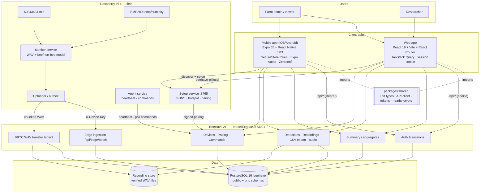

# BeeHave — Web & Mobile Architecture (for diagramming)

Source: the code in this repository as of 20 Oct 2026. Each section below is meant to become one box, group or arrow in a diagram. A ready-to-render Mermaid version is at the end.

---

## 1. Layers at a glance (draw top → bottom)

| # | Layer | What lives there |
|---|---|---|
| 1 | **Users** | Farm administrator / viewer, researcher (viewer), Sample Farm visitor |
| 2 | **Client apps** | Web app (browser), Mobile app (iOS / Android) |
| 3 | **Shared code** | `packages/shared` — used by Web, Mobile and API |
| 4 | **Backend API** | `apps/api` — Node.js / Express 5, port 3001 |
| 5 | **Data** | PostgreSQL 16 `beehave` DB (`public` + `brtc` schemas) + recording file store |
| 6 | **Edge (field)** | Raspberry Pi 4 at the coconut farm: monitor, agent, setup service, sensors |

---

## 2. Client apps

### 2a. Web app — `apps/web`
- **Stack:** React 19 · Vite 7 · TypeScript · React Router 7 · TanStack Query 5 · lucide icons
- **Layout:** sidebar navigation (`layout/AppLayout.tsx`)
- **Pages:** Sign-in · Dashboard · Activity · Detections → Detection details · Recordings → Recording details · Edge Devices · Settings
- **Auth:** HttpOnly same-site **session cookie**
- **Data fetching:** TanStack Query (15 s stale time, 1 retry, polling per refresh preference)
- **Audio:** HTML `<audio>` playback / WAV download
- **Network path:** browser → same-origin `/api/*` → Vite dev proxy → API `127.0.0.1:3001`
- **Nearby Pi setup:** looks up the known `beehave-pi.local` hostname

### 2b. Mobile app — `apps/mobile`
- **Stack:** Expo SDK 55 · React Native 0.83 · React 19 · TypeScript
- **Navigation:** horizontal tab strip — Home (Dashboard) · Activity · Detections · Audio (Recordings) · Devices · Settings; detail screens for detection / recording
- **Screens:** `SignInScreen`, `OverviewScreen` (Dashboard + Activity), `RecordsScreen`, `RecordDetailsScreen`, `DevicesScreen`, `SettingsScreen`
- **Auth:** **bearer token** stored in Expo **SecureStore**
- **Data fetching:** `useRemote` hook (in-memory, refresh every 60 s while app is active)
- **Audio:** Expo Audio with `Authorization: Bearer` header
- **Charts:** react-native-svg
- **Nearby Pi setup:** `react-native-zeroconf` (Bonjour / Android NSD) discovering `_beehave._tcp`
- **Network path:** phone → `EXPO_PUBLIC_API_URL` (LAN address of the API) → API `:3001`

### 2c. Shared package — `packages/shared`
- Zod schemas / domain types (detections, recordings, readings, devices)
- `createApi()` HTTP client used by both clients
- Date formatting (Asia/Manila), design tokens, branding assets
- `nearby.ts` — encrypted nearby-setup protocol (`@noble/ciphers`, `@noble/hashes`)

---

## 3. Backend API — `apps/api` (Express 5, Node 20, `tsx`)

Middleware: JSON body parser (2 MB), rate limiting on auth/pairing, session auth (cookie **or** bearer), farm-scoped access checks.

| Module (route file) | Endpoints | Used by |
|---|---|---|
| **Auth** `routes/auth.ts` | `POST /api/auth/register` · `login` · `demo` · `logout` · `password` · `GET /api/auth/me` | Web, Mobile |
| **Summary** `routes/summary.ts` | `GET /api/summary?from&to&device` (dashboard + activity aggregates) | Web, Mobile |
| **Records** `routes/records.ts` | `GET /api/detections`, `/api/detections/:device/:id`, `…/audio` · `GET /api/recordings`, `/api/recordings/:device/:id`, `…/audio` · `GET /api/export` (CSV) | Web, Mobile |
| **Devices** `routes/devices.ts` | `GET/POST /api/devices` · `POST /api/devices/:id/unpair` · `/delete` | Web, Mobile |
| **Commands** `routes/commands.ts` | User side: `GET/POST /api/devices/:id/commands`, `…/cancel` · Pi side: `GET /api/edge/commands`, `POST /api/edge/commands/:id` | Web/Mobile + Pi agent |
| **Pairing** `routes/pairing.ts` | `POST /api/pairing/start` · `/complete` (Ed25519-signed) | Web/Mobile + Pi setup service |
| **Edge ingestion** `routes/edge.ts` | `POST /api/edge/batch` (detections, readings, recordings metadata, heartbeat/health) — `X-Device-Key` auth | Pi |
| **BRTC audio transfer** `routes/brtc.ts` + `brtc/*.mjs` | `/api/v2/*` chunked WAV upload → verification → canonical publication | Pi |
| **Health** `app.ts` | `GET /api/health` | Monitoring |

Services: `sessions`, `devices`, `records`, `audio-windows` (slices a 3-s detection clip out of the verified WAV on demand), `date-range`.

---

## 4. Data layer

**PostgreSQL 16 — database `beehave` (localhost:5432)**

- `public` schema (app data): `farms`, `accounts`, `sessions`, `devices`, `readings`, `detections`, `recordings`, `device_pairings`, `device_commands`, `detection_audio_windows`
- `brtc` schema (audio transfer pipeline, 16 tables): `devices`, `sessions`, `recordings`, `assets`, `uploads`, `verification_jobs`, `canonical_assets`, `beehave_recording_links` (crosswalk), …

**Recording file store** — `apps/api/data/brtc/` (`candidates/`, `canonical/`) on the API host; verified original WAVs.

Key relationships (for an ER sub-diagram):
`farm 1─* account` · `farm 1─* device` · `device 1─* detection / reading / recording` · `detection → reading, recording` (by id in JSON) · `recording ↔ brtc.canonical_asset` (via `beehave_recording_links`)

---

## 5. Edge — Raspberry Pi 4 (field device)

| Component | Role | Talks to |
|---|---|---|
| **ICS43434 I²S microphone** | Hive/flower audio, 16 kHz mono | Monitor |
| **BME280 sensor** | Temperature, humidity | Monitor |
| **`beehave-continuous.service`** (monitor) | Records 60-min WAVs, runs bee / non-bee model on 3-s windows, writes `classifications.csv` + SQLite | Local disk |
| **`beehave-agent.service`** (`scripts/edge_agent`) | Heartbeat + health every 30 s; polls and runs remote commands (start/stop/restart monitoring, reboot, shutdown) | API `/api/edge/*` |
| **Observation + WAV uploader** | Sends detections/readings to `/api/edge/batch` and WAVs via BRTC `/api/v2` (`scripts/edge_queue.py` = durable SQLite outbox) | API |
| **`beehave-setup.service`** (`scripts/nearby_setup`) | Nearby pairing + Wi-Fi setup, HTTP :8765, Avahi `_beehave._tcp`, fallback hotspot | Web/Mobile on LAN, API `/api/pairing` |

---

## 6. Connections (arrows to draw)

| From | To | Protocol / auth | Carries |
|---|---|---|---|
| Web browser | API | HTTPS/HTTP `/api/*`, session cookie | All user reads, auth, device mgmt |
| Mobile app | API | HTTP(S) JSON, Bearer token | Same endpoints as Web |
| Web & Mobile | `packages/shared` | build-time import | Types, schemas, API client |
| API | PostgreSQL | `pg` driver (`DATABASE_URL`) | All persistent data |
| API | File store | filesystem | Canonical WAVs |
| Pi agent | API | HTTP, `X-Device-Key` | Heartbeat/health, commands poll/ack |
| Pi uploader | API | HTTP, `X-Device-Key` | `/api/edge/batch` metadata, `/api/v2` WAV chunks |
| Mobile app | Pi setup service | mDNS discovery + HTTP :8765, encrypted | Wi-Fi setup, pairing |
| Web app | Pi setup service | `beehave-pi.local:8765` | Pairing |
| Pi setup service | API | signed Ed25519 | `/api/pairing/start|complete` |
| Mic + BME280 | Monitor | I²S / I²C | Raw audio, sensor values |

---

## 7. Main user flows (optional sequence diagrams)

1. **Sign in:** Client → `POST /api/auth/login` → API checks scrypt hash → session (cookie on web / token in SecureStore on mobile).
2. **View dashboard:** Client → `GET /api/summary` → API aggregates `detections` + `readings` for farm/device/date → charts.
3. **Play a recording:** Client → `GET /api/recordings/:device/:id/audio` → API streams verified WAV (or a 3-s detection window).
4. **Pi data in:** Monitor writes CSV/WAV → uploader → `/api/edge/batch` + `/api/v2` → PostgreSQL + file store → visible on Web & Mobile.
5. **Pair a new Pi:** Mobile discovers `_beehave._tcp` → setup code → Pi signs → `/api/pairing/complete` → device appears under Edge Devices.
6. **Remote command:** Admin taps "Restart monitoring" → `POST /api/devices/:id/commands` → agent polls `/api/edge/commands` → runs → acks.

---

## 8. Mermaid (paste into mermaid.live, draw.io → Arrange → Insert → Advanced → Mermaid, or GitHub)

